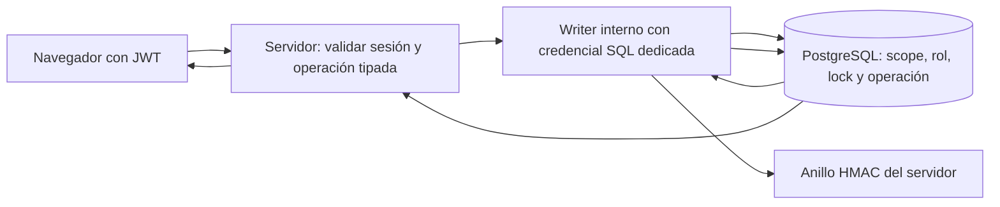

# ADR propuesta · N1-03 / S1 · escritor confiable de auditoría

> **DECISIÓN U01 APROBADA · 15/10/2026:** el propietario autoriza **desarrollo y pruebas locales** de escritor SQL dedicado sin BYPASSRLS, firma HMAC en servidor, transacciones por proyecto y outbox para retiradas; `provider_results` es subbloque de seguridad explícito. Ver [DECISION-U01-APROBACION-20261015.md](DECISION-U01-APROBACION-20261015.md). La validación de pooling/transporte precede a la implementación definitiva; si no es viable, volver a solicitar decisión. Secretos y migraciones alojadas requieren autorización separada. El título original «propuesta» y las preguntas de operación que siguen son históricos o quedan pendientes para despliegue real.

**Estado:** propuesta para U01, sin aprobación ni implementación. **Corte:** 15/10/2026, `main@3eba9d014a339dabdabff28f42e27209695b0bf9`; S2 permanece en PR #100. Esta ADR no crea roles, credenciales ni migraciones y no autoriza cambios alojados.

## Decisión propuesta

Usar un **escritor de servidor con identidad SQL dedicada**, sin `BYPASSRLS`, sin administración de Auth y sin acceso público a una RPC que firme payloads arbitrarios. La aplicación valida el JWT, resuelve de nuevo en la base el actor, proyecto, organización y rol efectivo, y genera la acción/detalles desde una operación tipada. El escritor mantiene una transacción por proyecto: bloquea la secuencia, verifica el extremo de la cadena con el anillo del servidor, calcula y firma el evento con la canonicalización actual del Core, inserta y confirma. El navegador nunca recibe la credencial SQL ni el anillo.

La cuenta SQL solo puede ejecutar operaciones internas aprobadas y leer lo mínimo para comprobar actor, scope y cadena. El inventario exacto de `GRANT`, políticas RLS y funciones de consulta se cerrará en el diseño de migración; queda prohibido convertir esta propuesta en `service_role` global o en un rol con `BYPASSRLS`. Si el transporte de Vercel a PostgreSQL no permite una transacción estable con pooling y tiempo acotado, la alternativa es un servicio escritor aislado; no se degradará a `read → sign → insert` en llamadas Data API separadas.

## Evidencia y superficies

La migración `20261007120000_core_9_2_audit_and_provenance.sql` concede INSERT por columnas en `public.audit_events` a `authenticated`. La política `members append audit events as themselves` coteja `actor_id` y rol, mientras `private.link_audit_event` serializa `seq`/`prev_hash`/tiempo mediante un advisory lock por proyecto. **Ninguno verifica la firma.** Cualquier miembro con JWT válido puede ocupar una secuencia con HMAC falso; la lectura detecta la firma inválida, pero la inmutabilidad impide repararla como un evento normal.

`src/lib/provenance/repository.ts::appendAudit` lee el último evento, firma con `buildAuditRow` y escribe con el cliente Supabase del usuario; reintenta tres veces ante colisión de secuencia. No verifica criptográficamente el último evento antes de construir el siguiente. `src/lib/provenance/audit.ts` firma `rubik-audit-v1:` + hash, y `verifyAuditTrail` comprueba cadena y HMAC. `src/lib/provenance/keyring.ts` carga `PROVENANCE_SIGNING_KEYS` y `PROVENANCE_ACTIVE_KEY_ID` en servidor y conserva claves retiradas para verificar historia.

| Camino | Riesgo de transición que exige prueba |
|---|---|
| `imports/repository.ts` y `eraseProviderResults` | Importación o borrado se confirma antes de append; una caída deja operación sin evento. Denegación/duplicado también intenta append. |
| `openseo/actions.ts` y `openseo/google/capture.ts` | La acción externa o el resultado firmado puede completarse antes del audit. Google devuelve `audited:false` si falla el append; un replay ya almacenado no crea otro evento. No repetir llamadas a proveedor al reintentar auditoría. |
| `people-actions.ts::removePersonAction` | La retirada de acceso ocurre primero y puede quedar sin evento. La UI ya muestra `retirada-sin-auditoria`; no revertir una revocación de seguridad por una caída del writer sin decisión explícita. |
| Ruta `exportar` | Registra `project.export` antes de generar el manifiesto. Definir si un fallo de exportación requiere evento de error y si la descarga solo se sirve tras confirmación del append. |
| `restore/plan.ts` | Restaura IDs, hashes y firmas verificados en una transacción administrativa; necesita una vía separada y acotada, sin volver a abrir INSERT a JWT ordinarios. |
| `provider_results` | También acepta datos firmados desde `authenticated`; su HMAC se verifica al leer, pero un JWT puede almacenar basura firmada falsamente. Registrar como riesgo conexo y decidir si se incluye en N1-03. |

## Contrato y límites de confianza

El servidor obtiene la identidad del usuario de una sesión verificada, no de `user_metadata`, campos del formulario o un `actor_id` elegido por el cliente. El writer recibe una orden interna con identificador de operación, actor, proyecto, parámetros validados e idempotency key; vuelve a consultar membresía y rol dentro de la transacción. Los detalles de auditoría se derivan del efecto confirmado. Una revocación concurrente debe serializarse con la operación o hacer que esta aborte; documentar el orden de locks para evitar deadlocks. La credencial SQL y el anillo son dos secretos distintos; la primera no puede leer ni exportar el segundo.

El rol escritor necesita CONNECT y permisos mínimos sobre objetos concretos; acceso a membresías mediante una función interna acotada, lectura del último evento e INSERT solo en el canal auditado. No debe tener UPDATE/DELETE de auditoría, acceso a `auth.users` más allá de la validación requerida, `CREATEROLE`, `CREATEDB`, propiedad de tablas ni `BYPASSRLS`. La función interna, si es SECURITY DEFINER, fija `search_path`, revoca EXECUTE de PUBLIC/anon/authenticated y valida parámetros. La restauración usa identidad administrativa separada y un procedimiento revisado con exportación verificada.

## Atomicidad, concurrencia e idempotencia

Para operaciones puramente SQL, efecto y evento se confirman en **la misma transacción** o ninguno se confirma. Bloquear por proyecto antes de leer el último `seq`; verificar HMAC/hash del extremo y, en recuperación o sospecha de corrupción, la cadena completa. Si el extremo es inválido, abortar y conservar evidencia. Firmar después de fijar `seq`, `prev_hash`, actor, rol y detalles definitivos. Evitar locks globales; un timeout o conflicto reintenta una orden con la misma clave de idempotencia y resultado persistido, sin duplicar evento.

Una llamada externa a Google/OpenSEO no cabe en la transacción de base. Antes de habilitar esos flujos, definir una **reserva/outbox transaccional** con estado e idempotencia, y un evento final ligado al resultado almacenado. No repetir una llamada facturable para reparar un audit fallido. Para `member.withdraw`, priorizar revocar acceso y registrar un recibo pendiente duradero en la misma transacción; el writer firma después y el estado visible sigue indicando que el audit está pendiente. Esta excepción al append sincrónico requiere aprobación U01 y prueba de recuperación. Las denegaciones de usuarios sin membresía no pueden escribirse en la cadena de un proyecto que no pueden leer: se propone un registro de seguridad separado con retención y acceso administrativo; decidir su alcance antes de implementarlo.

## Custodia y rotación

Reutilizar la canonicalización del Core y el formato actual de firmas para no invalidar exportaciones antiguas. Custodiar `PROVENANCE_SIGNING_KEYS` fuera de repositorio, navegador, logs y base; el propietario controla generación, respaldo y activación. Añadir clave nueva y cambiar `PROVENANCE_ACTIVE_KEY_ID` para nuevos eventos; conservar claves históricas hasta que termine la retención de exportaciones. Ensayar revocación de credencial SQL y rotación de anillo por separado. Un key ID desconocido, clave ausente o extremo inválido bloquea la escritura y no produce firma vacía.

## Alternativas evaluadas

| Alternativa | Evaluación |
|---|---|
| Servicio escritor aislado con autenticación interna | Adecuado si el runtime actual no sostiene una transacción SQL segura. Añade despliegue, identidad de servicio, observabilidad y coste operativo; mantener como plan B sujeto a U01. |
| Verificación HMAC en PostgreSQL | Cerraría INSERT falso si el secreto fuera inaccesible al JWT y la canonicalización coincidiera byte a byte. Duplica custodia y lógica del Core, complica rotación/restauración y deja atomicidad de acciones sin resolver. No elegir sin prototipo y revisión. |
| RPC pública SECURITY DEFINER o lista de acciones | Una RPC que acepte campos/firma arbitrarios sigue permitiendo contaminar la cadena; una lista de acciones no autentica HMAC. Descartada. |
| `service_role` global | Amplía el impacto de una fuga a Auth y tablas ajenas, y elude RLS. Descartada como identidad ordinaria del writer. |

## Entrega, rollback y aceptación

1. Tras integrar S2 y aprobar U01, probar conexión SQL y transacciones **solo en stack local aislado**. Medir pooling, timeout y comportamiento ante pérdida de conexión. Diseñar ACL, RLS y funciones por catálogo; no crear secretos reales durante el desarrollo.
2. Migrar todos los callers y mocks. Añadir writer, outbox donde corresponda, recibos e idempotencia; negativas por JWT y pruebas de concurrencia/revocación. La migración revoca INSERT de tabla **y columna** a PUBLIC/anon/authenticated y retira su política en la misma entrega coordinada. Comprobar también UPSERT/RPC alternativas.
3. Restauración administrativa: verificar exportación completa y anillo, ejecutar plan transaccional, comparar hashes/firmas y negar corrupción/truncado. Ensayar rollback local de esquema y aplicación. El rollback alojado, si llegase a necesitarse, no reabre INSERT ordinario sin una decisión explícita de riesgo.
4. Gate: verify, integración, pgTAP, E2E seguros, restauración/exportación, concurrencia, idempotencia, revocación, rotación y fallo del writer, todos por SHA. Publicar PR Draft separada, auditar HEAD y obtener autorización específica antes de migración alojada.

**Decisiones del propietario U01:** (a) rol SQL dedicado o servicio aislado tras comprobar transporte/pooling; (b) custodio y mecanismo de entrega/rotación de credencial y anillo, sin valores en chat; (c) semántica de retirada y borrado con outbox; (d) destino/retención de denegaciones sin membresía; (e) inclusión de `provider_results` en el mismo bloque y coste aceptable. ChatGPT supervisor debe auditar estos límites antes de autorizar la PR de producto.
